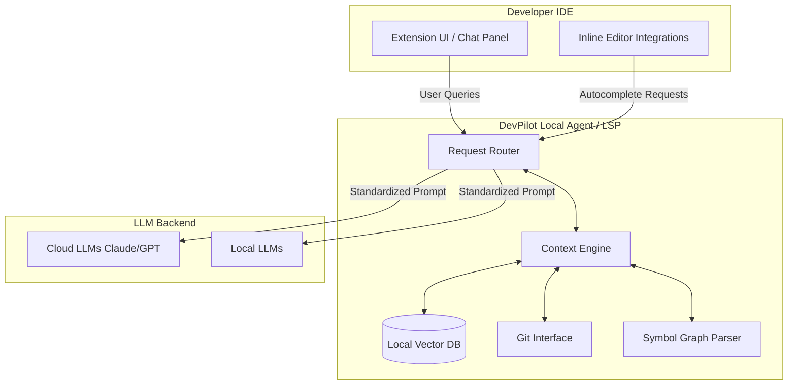

# Architecture Decision Record (ADR)

## 1. Initial Architecture & Foundational Decisions

**Date:** 2026-07-14
**Status:** Proposed
**Context:** DevPilot AI - Intelligent Developer Assistant (Phase 0)

### 1. Target User & Top 3 Workflows (MVP)
*   **Target User:** Professional software engineers working in medium-to-large codebases who need quick onboarding, context-aware suggestions, and automated boilerplate generation.
*   **Top 3 Workflows (Phase 1 Focus):**
    1.  **Chat with Codebase Context:** An interactive panel where developers can ask questions like "Where is the authentication logic?" and get answers grounded in their specific repo.
    2.  **Inline Edit & Autocomplete:** Single-line and multi-line intelligent code completion directly in the editor, aware of surrounding context.
    3.  **Explain & Debug:** Quick actions to "Explain this code" or "Diagnose this error" based on selected text or terminal output.

### 2. Core Architecture Strategy
*   **Decision:** Hybrid Extension Host + LSP-based Agent
*   **Rationale:** To achieve Phase 5's goal of "Multi-IDE support" while maintaining tight IDE integration for Phase 1's "Chat panel" and "Inline completion", a Language Server Protocol (LSP) backend is best. The LSP handles the heavy lifting (context ingestion, model communication) while lightweight, IDE-specific extension hosts (VS Code, JetBrains, Antigravity) handle the UI.

### 3. Model Routing Layer
*   **Decision:** Multi-Model Abstraction (Model-agnostic Core)
*   **Rationale:** As per the Guiding Principles, we need a swappable backend. We will implement a routing layer that standardizes prompts and context before sending them to the chosen provider (OpenAI, Anthropic, or Local models via Ollama/LM Studio). This also mitigates vendor lock-in.

### 4. Context Ingestion Strategy
*   **Decision:** Multi-tiered Context Engine (File Tree + RAG + Symbol Graph)
*   **Rationale:**
    *   *Baseline:* File tree and active document state.
    *   *Search:* Local vector database (Embeddings) for fast Retrieval-Augmented Generation (RAG) on saved files.
    *   *Precision:* Abstract Syntax Tree (AST) / Symbol Graph parsing to accurately locate definitions, references, and dependencies.
    *   *History:* Git integration to understand "what changed recently" to inform context.

### 5. Security and Data Handling Policy
*   **Policy Draft:**
    *   **Data Residency:** Source code never leaves the user's local machine unless explicitly sent to a remote LLM API.
    *   **Telemetry:** Opt-in only. All collected analytics (time saved, acceptance rate) must be completely anonymized and stripped of PII and source code snippets.
    *   **Enterprise Tier (Phase 4):** Support Bring-Your-Own-Key (BYOK) and VPC deployments to guarantee complete data isolation for enterprise clients.

## System Diagram (High-Level)

## Open Risks / Decisions Needed
1.  **Default Autonomy:** Should we default to "Ask before any edit" (Safe) or "Auto-apply with undo" (Fast)?
2.  **Cost Model:** Do we pass API tokens directly to the user (they bring their own OpenAI key) or bundle it in a flat subscription?
